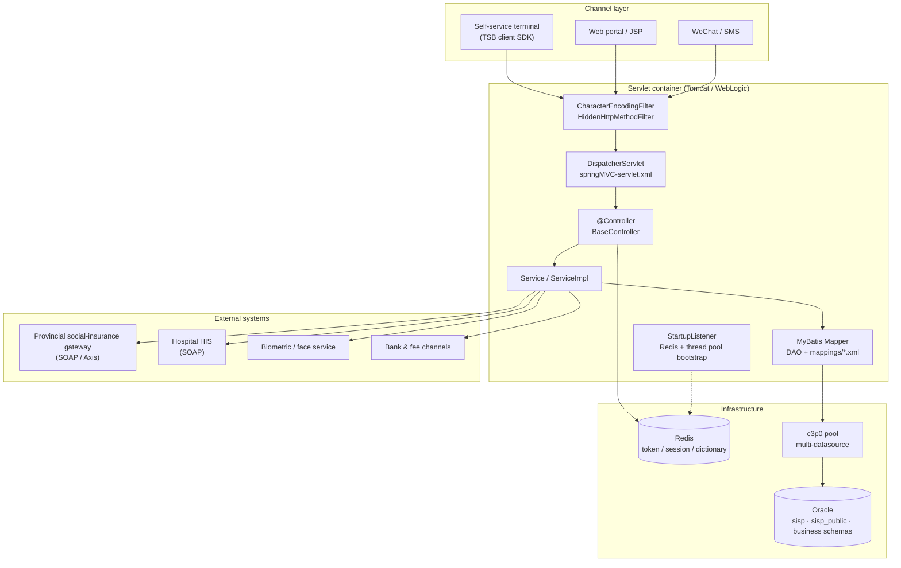

# Mestudy

**A reference implementation of a Chinese social-insurance / e-government backend.**

[](#tech-stack)
[](#tech-stack)
[](#tech-stack)
[](#build-from-source)
[](https://github.com/zengyunhua/Mestudy/actions/workflows/ci.yml)
[](LICENSE)

---

For maintainers preparing an open-source programme application, see the [application readiness and independent-reproduction guide](docs/OPEN_SOURCE_APPLICATION_GUIDE.md).

## What this is

Mestudy is a multi-module Maven workspace that collects the backend services behind a
provincial social-insurance and online government-service platform. It is not a toy
sample: the modules implement real business flows — social-insurance contribution
queries, social-security card lifecycle, employment/job-seeking services, hospital
registration, face verification, electronic signature, and draft-based online
service applications.

The code is published as a **reference architecture** for engineers who have to build
or maintain systems with the same shape: a servlet container, XML-wired Spring,
MyBatis mappers against Oracle, Redis-backed sessions, SOAP bridges to legacy
government interfaces, and a token-authenticated HTTP client SDK for downstream
terminals.

If you are looking for a modern Spring Boot starter, this is deliberately not one.
The value here is the *domain modelling* and the *integration patterns* that show up
when a Java system has to talk to a dozen heterogeneous government backends.

## Why it is worth reading

| Pattern | Where to look |
| --- | --- |
| Token-authenticated client SDK with self-renewing heartbeat | [`IFaceHttpsClient`](IFaceSuportService/src/main/java/com/tecsun/sisp/iface/client/IFaceHttpsClient.java) |
| Uniform response envelope shared by ~350 endpoints | [`Result`](IFaceSuportService/src/main/java/com/tecsun/sisp/iface/common/vo/Result.java) |
| Multi-datasource wiring with c3p0 + MyBatis | [`applicationContext.xml`](IFaceSuportService/src/main/resources/config/applicationContext.xml) |
| SOAP (Axis) → REST adapter for a legacy HIS system | [`HangTianHisController`](IFaceSuportService/src/main/java/com/tecsun/sisp/iface/server/controller/his/HangTianHisController.java) |
| Draft / submit / audit state machine for online services | [`DraftsController`](NetworkOfficeService/src/main/java/com/tecsun/sisp/net/modules/controller/userNet/DraftsController.java) |
| Startup-time resource bootstrapping | [`StartupListener`](IFaceSuportService/src/main/java/com/tecsun/sisp/iface/server/util/StartupListener.java) |

## Module map

| Module | Artifact | What it does | Size |
| --- | --- | --- | :---: |
| [`IFaceSuportService`](IFaceSuportService/README.md) | `sisp_IFaceSuportService` | Core interface service. Social-insurance queries, card services, employment, hospital, face verification, SMS, WeChat, bank/fee channels. Also ships the reusable **client SDK** jar (`classifier=client`). | 286 Java files |
| [`NetworkOfficeService`](NetworkOfficeService/README.md) | `sisp_NetworkOfficeService` | Online government-service portal. Application drafts, submission, audit trail, electronic signature (PDF stamping), area/administrative division data. | 129 Java files |
| [`IFaceSuperService_hn`](IFaceSuperService_hn/README.md) | `sisp_IFaceSuperService_hn` | Province-specific (Henan) variant of the interface service: card + social-insurance controllers against the provincial gateway. | 60 Java files |
| [`InterfaceFunction`](InterfaceFunction/README.md) | `sisp_InterfaceFunction` | Platform security administration: users, roles, function/permission trees, login. | 49 Java files |
| [`NetPortalManagement`](NetPortalManagement/README.md) | `sisp_NetPortalManagement` | Lightweight portal administration: portal users, policy documents, external web-connection registry. Uses standard JDBC and Jersey with a configurable API-token filter. | 16 Java files |

All modules share the group id `com.tecsun.sisp` and are packaged as `war` for
deployment into a servlet container.

## Architecture

The diagram and request lifecycle below describe `IFaceSuportService`, not a
universal architecture for all five modules. Four modules use Spring MVC and MyBatis;
`NetPortalManagement` uses standard JDBC/Jersey. There is no shared
`common` artifact —
each module carries its own copy of `common`/`util`, which keeps modules independently
deployable at the cost of some duplication.



### Request lifecycle

1. `web.xml` loads `config/applicationContext.xml` into the root context and registers
   `StartupListener`, which initialises the Redis pool (`DataBase.init()`) and the
   shared thread pool (`ThreadPoolUtil.init()`) before the first request is served.
2. `DispatcherServlet` is mapped to `/` and scans only `@Controller` beans from
   `com.tecsun.sisp.iface.server.controller`.
3. Controllers extend `BaseController` and return a `Result` (`statusCode` / `message` /
   `data`) or a `ResultVerify` for paged payloads. `statusCode` is `"200"` on success and
   `"0"` on failure — see [API overview](docs/API_OVERVIEW.md).
4. Services delegate to MyBatis mappers; mapper XML lives in
   `src/main/resources/mappings/` and is bound in `applicationContext.xml`.
5. Calls to legacy government systems go through Axis-generated SOAP stubs or the
   Jersey/`HttpClient` helpers, and are wrapped so a downstream outage degrades into a
   `Result` with a failure code rather than a 500.

## Tech stack

| Concern | Choice | Notes |
| --- | --- | --- |
| Language / runtime | Java 8 (source/target 1.8) | Level is set once in the root POM via `maven.compiler.source`/`target`; modules must not override it |
| Web framework | Spring MVC 4.0.8.RELEASE | XML configuration, no Spring Boot |
| Persistence | MyBatis 3.2.4 and JDBC | Mapper interfaces + XML in the Spring modules; parameterized JDBC repositories in portal administration |
| Connection pool | c3p0 (`ComboPooledDataSource`) where configured | `NetworkOfficeService` uses `DriverManagerDataSource`; `NetPortalManagement` opens scoped JDBC connections |
| Database | Oracle 10g/11g | Multiple schemas per module |
| Cache / session | Redis via Jedis | Dictionary cache, interface token, channel state |
| SOAP | Apache Axis 1.x | Generated stubs for provincial gateway / HIS |
| HTTP client | Apache HttpClient 4.1 + Jersey 1.15 | Client SDK and inter-service calls |
| JSON | Gson + `net.sf.json` | Both are in use; new code should prefer Gson |
| Logging | SLF4J + Log4j 1.2 | `log4j.properties` / `log4j.xml` per module |
| Packaging | `war` | Servlet 2.5 descriptor |

## Build from source

### Prerequisites

- JDK 8 required — it is both the build JDK and the language level. JDK 9+ compiles
  the sources but warns that source/target 8 is obsolete; JDK 11+ will need `--add-opens`
  workarounds for Axis and c3p0
- Maven 3.2+
- A servlet container (Tomcat 7/8, or WebLogic 12c)
- Oracle and Redis instances if you want the application to actually start

### Build

```bash
git clone https://github.com/zengyunhua/Mestudy.git
cd Mestudy

# Build and verify all five modules
mvn -B verify

#   IFaceSuportService/target/IFaceSuportService-V1.0.0.150630.war         -> deploy
#   IFaceSuportService/target/IFaceSuportService-V1.0.0.150630-client.jar  -> client SDK
#   IFaceSuperService_hn/target/IFaceSuperService_hn-V1.0.0.190107.war
#   InterfaceFunction/target/InterfaceFunction-V1.0.0.150630.war
#   NetworkOfficeService/target/NetworkOfficeService-V1.0.0.180612.war
#   NetPortalManagement/target/NetPortalManagement-V1.0.0.150630.war
```

The repository root holds an aggregator `pom.xml`, so Maven works from the top of the
tree. All five modules now resolve from public dependencies and are part of the default
reactor. Each module keeps its own coordinates and version — the root POM supplies the
module list, plugin versions, source encoding and Java 8 compiler level (1.8).

### Verify without external services

On JDK 8, run the public modules' unit tests without Oracle, Redis, or a deployed
servlet container:

```bash
mvn -B test
```

The public reactor now includes `NetPortalManagement`; its JDBC repositories compile
without proprietary artifacts. The existing tests cover client, filter, paging, utility,
controller, Spring-context and build-hygiene behavior; they do not prove deployment or
cover every Oracle business flow. CI runs the same command with forked tests against an
isolated Maven repository, then applies `scripts/verify_public_build.py` to all WARs and
Surefire reports.
Legacy HTTP smoke tests are intentionally excluded from this command because they
require a running deployment and local fixtures. On Windows, if Surefire cannot start
a forked JVM because `%TEMP%` contains non-ASCII characters — the usual case when the
account name is Chinese — point the temp directory at an ASCII path:
`mvn -B -Djava.io.tmpdir=D:\mvn-tmp package` (create the directory first).
`-DforkCount=0` also works but loses per-test isolation. See
[troubleshooting](docs/TROUBLESHOOTING.md).
This is a **public dependency build**, not a claim that a fresh clone has an Oracle
database or platform proxy available. `NetPortalManagement` now starts only after its
JDBC and API-token configuration is supplied.

### Which modules build publicly

| Module | Public build | In default reactor | Blocking dependency |
| --- | --- | :---: | --- |
| `IFaceSuportService` | yes | yes | — |
| `IFaceSuperService_hn` | yes | yes | — |
| `InterfaceFunction` | yes | yes | — (the private coordinates it declared were unused and are gone) |
| `NetworkOfficeService` | yes | yes | — (one missing entity class was reconstructed) |
| `NetPortalManagement` | yes | yes | Oracle JDBC, external platform proxy for photo/log endpoints, and a configured API token |

Two modules needed work to get here, and they needed different things.

`InterfaceFunction` declared `com.tecsun.sisp_public:aamanagement-client` and
`bee:xx.tool`. No source file imports either, no `Class.forName` mentions them, and the
former `web.xml` references to the AAM client were only commented-out filters
(now removed) —
so they were dead declarations copied from a sibling POM. `NetworkOfficeService` was the
same.

`NetworkOfficeService` needed a second fix on top of that: removing the declarations
exposed a missing source file. Four classes and
`mappings/draftsDAO.xml` refer to
`com.tecsun.sisp.net.modules.entity.response.BanjianVo`, which was never published. It
has been reconstructed in
[`BanjianVo.java`](NetworkOfficeService/src/main/java/com/tecsun/sisp/net/modules/entity/response/BanjianVo.java)
from the columns the mapper proves exist, with the provenance recorded in its Javadoc.
That is the one place in this repository where the code is not the original: if you have
the real schema, diff it against your DDL.

Compiling was not the same as packaging correctly. The same module also shipped
`javax.servlet:servlet-api` and `spring-test` inside `WEB-INF/lib`, pointed one datasource
at another schema's `${jdbc.*}` key, loaded two of its three mapper XML files, and mapped
`/views/**` at `WEB-INF/` itself — which served `classes/config.properties` on request.
All of that now fails a test instead of a deployment: `SpringContextLoadTest` loads the
real context and asserts every datasource URL and every mapper statement. The full list is
in the [CHANGELOG](CHANGELOG.md#unreleased).

`NetPortalManagement` previously depended on Bee ORM, Bee startup classes, `xx.tool` and
the AAM Jersey filter. Those dependencies have been replaced with plain DTOs, a
parameterized JDBC repository, standard Jersey servlet bootstrapping, `AppConfig` and a
fail-closed API-token filter. The migration preserves the existing resource paths while
making the security and configuration boundary explicit in the module guide.

Everything else — Spring, MyBatis, Axis, Jersey, kaptcha and the Oracle JDBC driver —
resolves from Maven Central.

> **Private mirrors.** The POMs no longer hard-code an internal Nexus. If your
> organisation proxies Maven Central, declare the mirror in `~/.m2/settings.xml`
> instead of in the project POM. See
> [docs/GETTING_STARTED.md](docs/GETTING_STARTED.md#using-a-maven-mirror).

### Run

```bash
# 1. Copy the configuration template and fill in your own values
cp IFaceSuportService/src/main/resources/config.properties.example IFaceSuportService/src/main/resources/config.properties

# 2. Deploy the war (context path is /sisp by convention)
cp IFaceSuportService/target/IFaceSuportService-*.war "$CATALINA_HOME/webapps/sisp.war"

# 3. Start the container
$CATALINA_HOME/bin/startup.sh
```

Port `8080` is only an example: use the Tomcat HTTP connector port and configure Oracle, Redis and all required data sources before deploying. A successful WAR build does not verify runtime behaviour. See [the deployment guide](docs/GETTING_STARTED.md#5-deploy-and-smoke-test-requires-infrastructure).

## Using the client SDK

`IFaceSuportService` publishes a slim client jar containing only `**/client/**` and
`**/common/**` classes. Consumers initialise it once, then call typed methods.

```java
// Initialise once per JVM. Spawns a heartbeat thread that renews the token.
IFaceHttpsClient.ClientInit(
        "10.0.0.10",   // host
        8080,          // port
        60,            // token refresh interval, minutes (floor is 60)
        false,         // useHttps
        "TSB",         // channel code
        "sisp"         // platform context path
);

// Then call the typed API
SecQueryBean bean = new SecQueryBean();
bean.setId("110101199001010015");
bean.setName("...");
bean.setChannelcode("SelfService");

Page<TsgrjfxxVO> page = IFaceHttpsClient.getPersonPesionPay(bean);
System.out.println(page.getData().size());
```

The heartbeat calls `POST {context}/iface/user/checkLogin` and stores the returned
`tokenId`; subsequent SDK requests send `X-Token-Id` as a header. Because the token is held
in a `static` field and the heartbeat thread is a singleton, **the SDK is bound to a
single target server per JVM**. See [docs/CLIENT_SDK.md](docs/CLIENT_SDK.md) for the
full reference.

## Configuration

Every module ships a `config.properties.example`; copy it to `config.properties` and
keep the real file untracked. The four Spring MVC modules read it through
`<context:property-placeholder ignore-unresolvable="true">`, so `${key}` resolves in
their XML — and an unknown key is left in place as the literal `${key}` rather than
failing at startup. `NetPortalManagement` resolves keys through `AppConfig`, which
checks a JVM system property, then `config.properties`, then an environment variable
(`jdbc.url` → `NPM_JDBC_URL`), and throws on a missing required key instead of returning
`null`. Its datasource is therefore `jdbc.*` in this same file, not a separate `ds.xml`,
and `api.token` is mandatory — the module refuses to start without it. See its
[module guide](NetPortalManagement/README.md).

| Key group | Purpose |
| --- | --- |
| `jdbc.<name>.*` | Driver, URL, credentials and pool sizing per datasource |
| `redis_core_database` | Redis endpoint as `host_port` |
| `redis_iface_expx` | Token / cache TTL in **minutes** (multiplied by 60 internally) |
| `platform_context_path` | Deployed context path, default `/sisp` |
| `inner_proxy_ip` / `inner_proxy_port` | Internal proxy used for inter-service calls |
| `biometrics.*` | Face-verification gateway endpoint and credentials |
| `signpdf.*` | Electronic-signature service endpoint, font and template paths |

Full reference: [docs/CONFIGURATION.md](docs/CONFIGURATION.md).

## API surface

The Spring MVC API commonly uses a `Result` envelope for JSON responses;
this is not a universal contract for Bee-dispatched `NetPortalManagement` endpoints:

```json
{
  "statusCode": "200",
  "message": "success",
  "data": { }
}
```

Paged endpoints add `pageNo`, `pageSize` and `count`:

```json
{
  "statusCode": "200",
  "message": "success",
  "data": [ ],
  "pageNo": 1,
  "pageSize": 20,
  "count": 137
}
```

Across the workspace there are **358 `@RequestMapping` declarations**, grouped by
domain prefix (`/iface/rest/`, `/iface/cardInfo/`, `/iface/user/`, ...). The
[endpoint index](docs/API_OVERVIEW.md) lists them by controller.

## Project status

This repository is a **curated archive of production-derived modules**, published for
reference. It is maintained on a best-effort basis.

- **Documentation**: in place — this README, one README per module, and the ten
  documents under `docs/`.
- **Public build scope**: five of five. All modules are in the default reactor and
  resolve from public dependencies; `NetPortalManagement` still needs Oracle and a
  configured platform proxy for meaningful runtime checks.
- **Tests**: limited but now covers every module. `scripts/verify_public_build.py`
  requires a nonempty WAR and at least one passing test per module, and CI runs it after
  `mvn -B verify`: 45 tests in total (12/8/7/4/14). The portal module's tests stop at the
  boundary — `AppConfig` resolution order and `ApiTokenFilter` rejection, neither of which
  needs a database. The JDBC repository itself is still uncovered and needs an
  Oracle-compatible fixture.
- **Modernisation**: not planned in-place. The intent is to keep the original
  Spring 4 / XML style intact so the patterns stay readable. The language level is
  Java 8 (raised from 7) and that is as far as it goes — no framework upgrade.

### Known limitations

These are documented on purpose — they are the honest state of the code, and each one
is a good first contribution.

1. **Oracle-backed runtime flows need infrastructure.** The public build compiles and
   packages all five modules, but portal queries, policy BLOBs and visit statistics still
   require an authorized Oracle schema. Photo/log endpoints also call the configured
   platform proxy.
2. **Historical sensitive-looking data needs owner review.** The current tree uses
   `.example` templates instead of tracked local `config.properties` / `ds.xml`, but
   Git history still contains credential-, payment-signing-key- and identity-shaped
   values. Their provenance and real-world use are unverified. The
   [security review](docs/SECURITY_REVIEW.md) records a category-only inventory and
   the evidence/approval process. If a value was provisioned, its owner must revoke
   or rotate it with the provider (especially payment signing material) before any
   coordinated history cleanup. Do not assume every match identifies a real person
   or a live secret; do not paste historical values into public channels.
3. **Duplicated `common` layer.** Each module re-implements `Result`, `Page`,
   `CommUtil`, `AESUtil`. 53 class names exist in more than one module, and 51 of those
   53 have drifted apart — only `DevBean` and `SecretKeyBean` are still byte-identical
   (between `IFaceSuportService` and `IFaceSuperService_hn`). The spread is wide:
   `Constants` exists in four copies of 895, 69, 31 and 30 lines; `BaseController` in
   five. Consolidating them into a shared artifact is the single most valuable refactor
   available here, but it is not a mechanical merge — the smallest copy is usually the
   only one a given module actually calls, so every divergence has to be resolved by
   reading its callers.
4. **Thin test coverage.** The client, filter and `Page` have focused assertion-based tests,
   but most business flows are not covered. Legacy HTTP smoke tests require a
   running service and local fixtures, so they are excluded from default tests.
5. **One release only.** `v1.0.0` is tagged and described in
   [CHANGELOG.md](CHANGELOG.md); the per-module artifact versions in the POMs still
   carry their original internal numbers (`V1.0.0.150630`, `V1.0.0.190107`) and are not
   aligned with it.

## Roadmap

See [docs/ROADMAP.md](docs/ROADMAP.md). Near-term:

- [x] Add a root aggregator POM so the workspace builds as one reactor
- [x] Remove the hard-coded internal Nexus from every POM
- [x] Replace non-public dependency coordinates with their Maven Central equivalents
- [x] Stop tracking `target/` and the real `config.properties` files
- [x] GitHub Actions: compile the buildable modules on JDK 8, plus repository hygiene checks
- [x] Raise the language level to Java 8 (source/target 1.8, set once in the root POM)
- [x] Tag `v1.0.0`
- [x] Bring `InterfaceFunction` into the default reactor (its private coordinates were unused)
- [x] Reconstruct `BanjianVo` so `NetworkOfficeService` builds publicly
- [x] Replace NetPortalManagement's private Bee/AAM runtime with public JDBC/Jersey components
- [ ] Add Oracle-compatible integration tests for NetPortalManagement repositories
- [ ] Scrub credentials and personal data from the git history
- [ ] Add JUnit + H2 tests for the `common` layer and one controller per module
- [ ] Generate an OpenAPI description from the existing controllers

## Documentation

| Document | Contents |
| --- | --- |
| [docs/GETTING_STARTED.md](docs/GETTING_STARTED.md) | Zero-to-running in ~15 minutes |
| [docs/ARCHITECTURE.md](docs/ARCHITECTURE.md) | Layering, contexts, request lifecycle, cross-cutting concerns |
| [docs/CONFIGURATION.md](docs/CONFIGURATION.md) | Every configuration key, with defaults |
| [docs/API_OVERVIEW.md](docs/API_OVERVIEW.md) | Response envelope, error codes, endpoint index |
| [docs/CLIENT_SDK.md](docs/CLIENT_SDK.md) | Using `IFaceHttpsClient` from a Java consumer |
| [docs/TROUBLESHOOTING.md](docs/TROUBLESHOOTING.md) | Build failures, encoding issues, Oracle/Redis gotchas |
| [docs/ROADMAP.md](docs/ROADMAP.md) | Where this is going |
| Per-module READMEs | Linked from the [module map](#module-map) |

## Contributing

Issues and pull requests are welcome — especially the items in
[Known limitations](#known-limitations). Please read
[CONTRIBUTING.md](CONTRIBUTING.md) first, and note that all participation is governed
by the [Code of Conduct](CODE_OF_CONDUCT.md).

Good first issues: adding a test, replacing a hard-coded constant with a configuration
key, translating a class-level comment into English Javadoc, or removing one module's
dependency on the private Nexus.

## Security

Do not open a public issue for a vulnerability. See [SECURITY.md](SECURITY.md).

## License

[Apache License 2.0](LICENSE).

Third-party attribution is recorded in [NOTICE](NOTICE). A small number of files
(`Dialect`, `PreparePaginationInterceptor`, `Reflections`) are copied from
[JeeSite](https://github.com/thinkgem/jeesite) and keep their original `@author`
tags — please leave those intact if you fork this project.

## Disclaimer

This codebase is derived from systems built for Chinese public-service institutions.
It is published for **educational and reference purposes**. It is not affiliated with,
endorsed by, or supported by any government agency. Credential- and identity-shaped
historical values have not all been verified as synthetic or never provisioned;
do not use them against live systems. You are responsible for complying with local law —
including personal-information protection rules — before deploying anything derived from
this repository.
